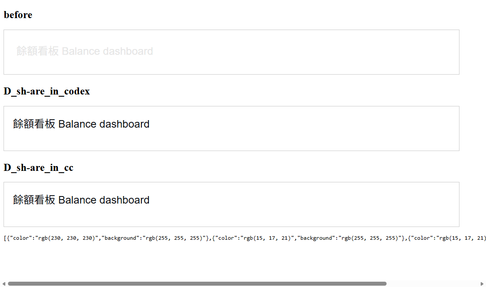

# DSH 主題顏色相容 / Theme compatibility

宿主預設白底，因此提供 DSH 官方淺色主題的靜態色與語意色變數，避免原插件使用深色備用值造成文字不可讀。此修正不啟用深色模式，也不修改第三方插件原始碼。

The white host provides upstream DSH light-theme tokens so plugins do not fall back to dark-theme colors. This does not enable dark mode or modify third-party plugin code. Existing generated packages must be regenerated to receive the updated runtime/ui/host.css.

Source: https://github.com/deepseek-ai/deepseek-harness/blob/master/packages/client/ui-theme/src/styles/design-platform.css

Upstream SHA256: `809b20ae477324fdf5181a2d338655a19919cabbf1b0e60adc149908462c5a66`

MIT notice: [DSH-theme-MIT.txt](../data/licenses/DSH-theme-MIT.txt). Only the two upstream default body token blocks are used; the host does not automatically select upstream dark or macOS-specific overrides.

## Verification / 驗證

Five focused tests passed for this package: UI packaging plus a generated-output palette dependency/contrast regression. Edge headless rendered the original balance-page color rule against the old white host and both updated hosts: text changed from rgb(230, 230, 230) to rgb(15, 17, 21), with a white background. This is a synthetic color fixture, not a full balance-plugin or Claude desktop test. No model calls or account access.

既有生成插件需重新轉換，才會取得更新的 runtime/ui/host.css；只重新整理舊頁面不會補上缺少的樣式。
